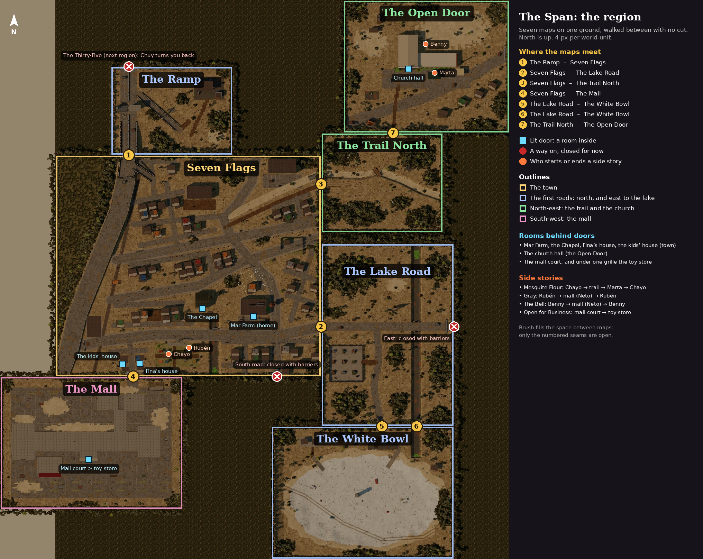

# The Span (region 1) and Seven Flags, its town

The first region: the town the game starts in, the road out north, and the
long road down to the dry lake.

**History:**
- **2026-10-26, first build:** five small maps (44 × 32).
- **2026-10-26, rebuilt at the owner's scale:** six maps up to 132 × 96.
- **2026-10-27, rebuilt around the owner's own map of the town:** "SEVEN
  FLAGS: the playable town, top-down", 192 × 160 units, built from the real
  streets of north Laredo.

Everything here follows `docs/design/world-methodology.md` and the style spec.
Items marked **[ASK]** are my guesses and need the owner's sign-off.

## Layout

```
  x:  0   40       128   192     288
  z:0     ┌────────┐
          │  RAMP  │ M (88×64)          north: the Thirty-Five (next region)
  z:64 ┌──┴─┬──────┴───────┐
       │    SEVEN FLAGS    │
       │  the town, 192×160│            east, past Memo's barricade on Del Mar:
  z:128│                   ├──────┐
       │                   │ LAKE │     east: the brush (not built)
  z:224└───────────────────┤ ROAD │
       west: the Dead River│96×132│
       south: McPherson    │      │
  z:260              ┌─────┴──────┤
                     │ WHITE BOWL │ 132×96, southeast of town
  z:356              └────────────┘
```

The region from straight above, as built (regenerate with
`npm run build && node tools/overview.mjs`):


The same region with how it joins up drawn on: each map's outline, the numbered seams where you walk from one map
into the next, the lit doors with rooms behind them, the ways on that are closed for now, and who starts or ends
each side story (2026-10-29: seven maps, with the trail, the church and the mall):



## Seven Flags (192 × 160)

North Laredo, disguised, laid out from the owner's map. North is up.

**The streets.** The town file draws them as centre lines, so a street can run
at any angle.
- **The Thirty-Five** runs up the west side on the diagonal, with the **rail
  line** beside it.
- **West of the Thirty-Five is outside the town:** brush to the horizon.
- **Del Mar** runs along the south and out east to Memo's barricade.
- **International and Shiloh** cut across on the diagonal.
- **McPherson** winds north to south.
- **Side streets** fill the blocks between them.
- **The dry creek** and **the Old Trail** beside it go off to the north-east.
- Streets are painted along their true lines, not the ground grid, so a
  diagonal has a clean edge.

**Where the story happens** (the owner's key):

| Place | What happens there | Built as |
|---|---|---|
| **Mar Farm** | Juno's home, a dead supermarket. Walk in to enter the interior. | The store with MAR on the roof, its door lit by a caged bulb, and the lot in front. Also: the water tank, the goats, and the burial platform where Papá lies. **Hermana Lupe** stands by it, where the game starts. |
| **The Plaza** | The night market, the seven flags, the well | Dead grass and two crossing paths. The flags (hero) stand along the north side, with stalls under strung bulbs. **Chayo, Beto, Rubén, Kit, Fina, Tavo and Nina** are here. |
| **The Chapel** | The elders' table | The chapel with its lantern door and belfry, and the long table outside, with **Abuela Toña** at it |
| **The drain** | The first fight | A concrete channel from behind the store south under Del Mar (black culverts) and out of town |
| **The Big Store** | Papá's salvage route (night two) | A big box with its doors chained, and a parking lot of wrecks |
| **The School** | The cellar (Nacho) | A brick school with a dirt yard and a dark cellar hatch: a way in for whoever brings a light |
| **The Old Trail** | Abuelo Nacho | A footpath north-east by the creek. **Nacho** stands at its foot, and the old bench with the carved heart is up the way. |
| **The dry creek** | La Llorona, the Keeper | A sunk sand bed running north-east to the big concrete pipe at the town's edge |
| **Abby's yard** | The mower, the swing | Dead grass behind a salvage fence: the Lawnkeeper mowing (routine), the swing, the shed with a chalk drawing |
| **The Warehouse** | A landmark, no story yet | Three stories of tin between the highway and the rail |
| **The east barricade** | Memo, the east edge of town | Barriers and a car on its side across Del Mar; **Memo** stands there |

**Homes.** About 65 lots follow the owner's map, block by block. They're
patched houses turned square to their streets, plus a few ruins and two
container homes, with yard tanks, laundry, and fires with a lantern beside
them.

**Lit doors** (each one leads into a room):

| Door | Light | Room |
|---|---|---|
| Mar Farm | caged bulb | Mar home |
| The chapel | a lantern, the door ajar | The Chapel |
| South of Del Mar, west of the plaza | light under the door | Doña Fina's |
| The house beside Fina's | a lit window | Tavo and Nina's |

Every other door is shut or boarded. The cellar hatch and the culverts are
dark: you'd need your own light.

## The other maps

| Map | Size, kind | Hero | Routine | Signature |
|---|---|---|---|---|
| **The Ramp** | medium; road leg, ruined: the road out | The overpass, half of it down across the southbound lanes | The checkpoint gantry over the exit ramp | The green sign face-down: the region's **one Old Name** |
| **The Lake Road** | large, stood on end; road leg, ruined | The billboard, peeled to nothing | The traffic light at the fork | The drain beside the road all the way to the lake |
| **The White Bowl** | large; landmark, empty on purpose | The intake tower | The buoy, still blinking | The white crust, nearly the whole map wide |

## Ways out of the region (not built yet)

Walking to these edges turns you back with a line instead of breaking the game.

- **North up the Thirty-Five,** past the Ramp.
- **East on Del Mar,** past the Lake Road's fork.
- **West on Del Mar,** under the Thirty-Five to the Dead River.
- **South on McPherson.**

## Open for the owner

1. **[ASK] People with no sprite yet.** The owner's map places Doña Lourdes,
   Inés, Rafa, Goyo, Güero, Mari, Chuy and Don Pepe. The sprite sheet has no
   faces for them, and the legacy files have no lines, so they aren't placed
   yet. They need the newer story file and new sprites.
2. **Papá** (settled 2026-10-27): he's dead when the game starts. He's the one
   on the burial platform, and he appears only in the old tale
   (`docs/design/legacy-breakdown.md`).
3. **[ASK] Toña and Fina moved outdoors** to match the map: Toña to the elders'
   table, Fina to the plaza. Their rooms are empty for now.
4. **[ASK] The title card** now says SEVEN FLAGS, and the region is still The
   Span. Say if the region should take the town's name.
5. **[ASK] Things I added that aren't on the owner's map:**
   - the long concrete pipe at the creek's end;
   - the cellar hatch drawn as a dark way in;
   - the Ramp's broken overpass;
   - the Lake Road and the White Bowl as they were.
6. **Streaming hitches.** Seven Flags is the biggest map. It builds at the start
   and again if you come back from the lake. That needs measuring on a real
   phone.
