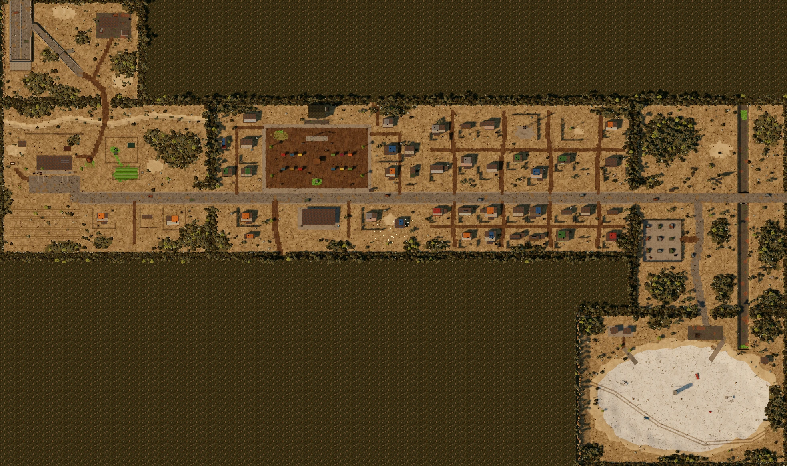

# The Span (region 1)

The first region: the town the game starts in, and the first stretch of road
before the highway. Built 2026-10-26 as the first test of the world methodology.
Real place: central Laredo, the Del Mar boulevard, Lake Casa Blanca, and the
I-35 on-ramp, under survivor names.

Everything here follows `docs/design/world-methodology.md` and the style spec.
Items marked **[ASK]** are my guesses and need the owner's sign-off.

## How it's built

- **One open region (methodology §2.4, option C).** Five sections of 44×32
  units sit on a grid and are walked between with no cut. Each section is built
  so it could stand alone as its own map if we ever need to split the region.
  - **Seams:** at a seam, both sides read each other's ground, and the terrain
    noise uses region coordinates, so roads, the drain and the height of the
    land carry straight across.
  - **Names:** a small name tag appears when you cross into a new section.
- **Lights:** many lamps, few lights. The region builds dozens of lamps but
  runs only ten real lights, which follow the camera.
- **Rooms:** separate small scenes behind lit doors, entered with a pixel
  dissolve. You come back out onto the step you went in from.

```
            x 0           44           88           132
  z 0   ┌────────────┐
        │  THE RAMP  │  → north: the Thirty-Five (next region)
  z 32  ├────────────┼────────────┬────────────┐
        │  MAR FARM  │ THE PLAZA  │  EAST ROAD │ → east: the brush (not built)
  z 64  └────────────┴────────────┼────────────┤
                                  │ WHITE BOWL │
  z 96                            └────────────┘
```

The region from straight above, as built (regenerate with
`npm run build && node tools/overview.mjs`):



## Sections

| Section | Kind and tier | Hero | Routine | Signature |
|---|---|---|---|---|
| **Mar Farm** (0,1) | Hold, lived-in | The water tower | The windmill pump filling the trough | The old store with MAR on the roof; its door lit by a caged bulb (they have panels) |
| **The Ramp** (0,0) | Road leg, ruined | Where the highway stops: the embankment sheared, the slab tipped into the dirt | The checkpoint gantry over the ramp, still sweeping, its lamp saying STOP | The green sign face-down. Underneath, out of the sun, it kept its letters: the region's **one Old Name** |
| **The Plaza** (1,1) | Hold, cluttered (market) going lived-in | The seven flags | The Lawnkeeper mowing the dust of a square it remembers | The night market under strung bulbs |
| **The East Road** (2,1) | Road leg, ruined | The billboard, peeled to nothing | The traffic light cycling for nobody | The drain crossing under the road, its culverts black |
| **The White Bowl** (2,2) | Landmark, ruined, empty on purpose | The intake tower, the old waterline banded on it | A buoy on its side on the dry bed, still blinking for boats | The white crust: the only ground in the Span that shines back at the moon |

**Seen, never said** (methodology §4.4), in the order you'd find them:
- the shroud on the burial platform at the farm;
- small six-wheeled tracks coming up out of the drain and heading east;
- big tread tracks crossing the whole Bowl. Memo: "bigger than any Stray".

## The door language as built

Every door you can open shows a light. A door with no light is not a way in.
The playtests assert this for every section and every room (`checkDoors`).

| Light | Means | Where |
|---|---|---|
| **Caged bulb** over the door (old tech, on the panels) | Home. Come in. | The Mar store |
| **Lantern** hung at the door, the door ajar | Open to anyone | The chapel |
| **Light under the door** | Someone's up; knock | Doña Fina's |
| **Lit window** beside the door | Someone's home | Tavo and Nina's |
| Shut, no light | Out, or asleep | A house on the Plaza; the restroom at the Ramp |
| Boarded | Nobody, not for a long time | A shed at the farm; a house on the Plaza |
| Dark mouth, dead bulb | A way in that needs your own light | The culverts under the East Road (a dungeon to come) |

## Rooms

| Room | Behind | Who's there |
|---|---|---|
| **Mar Farm** (inside the store) | The caged-bulb door | Nobody yet. The family's corners are curtained off with sheets, and one bed is made that nobody sleeps in. The staybook lies open on the table. |
| **The Chapel** | The lantern door | Abuela Toña |
| **Doña Fina's** | The light under the door | Doña Fina |
| **Tavo and Nina's** | The lit window | Nobody yet; the kids are out on the Plaza |

By night, a room's way out shows the night: a cool spill of moonlight at the
gap in the cut-away wall, and no lamp. The lamp is on the outside, for the
people coming in.

## People placed (lines from `legacy/poc2`)

| Section | People |
|---|---|
| Mar Farm | Hermana Lupe |
| The Plaza | Chayo, Beto, Rubén, Kit, Tavo, Nina, Nacho |
| The East Road | Memo |
| Inside | Abuela Toña (the Chapel), Doña Fina (her house) |

## Ways out of the region

These roads lead to pieces not built yet. Walking to the edge turns you back
with a line instead of breaking the game.

- **North up the Thirty-Five,** from the Ramp, toward the Gate.
- **East on the road into the brush,** from the East Road.

## Open for the owner

1. **[ASK] Names and layout.** I don't have the original sketch of the Span,
   so the map above is rebuilt from the methodology, the legacy story files,
   and the real geography. I named the sections the Ramp, the Plaza, the East
   Road and the White Bowl; "the Thirty-Five" is the I-35. Please correct
   any name or any section's placement.
2. **[ASK] Things I added that aren't in the story files:**
   - the Lawnkeeper, an old machine still mowing;
   - the checkpoint gantry, still watching the ramp;
   - the six-wheeled small tracks and the big tread tracks.

   Each one is a hook for later. Keep or cut each.
3. **[ASK] MAR on the roof.** Painted letters wouldn't survive the sun
   (methodology §3.3). My proposal: rebuild them as steel letters, with the
   rest of the name fallen away.
4. **[ASK] Rooms with nobody home.** The Mar store and Tavo and Nina's are
   empty for now. Should family members be home at night?
